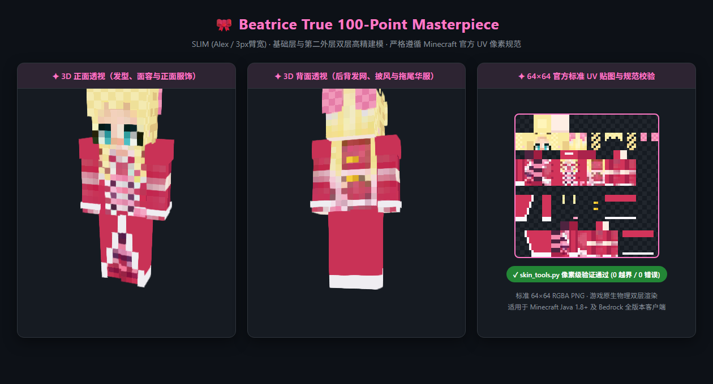

# 案例研究：Re:Zero 碧翠丝 (Beatrice) 高精 64×64 皮肤

本项目基于 `scripts/skin_tools.py` 与 `scripts/render_showcase.py`，完整展示了从 2D 动漫立绘/参考图到 Minecraft 64×64 高精皮肤的全流程制作与验证。



## 核心设计与规避的踩坑点

### 1. 8×8 幼态二次元面容法则（告别“下巴胡渣点”）
- **问题**：在 8×8 面部网格中，如果盲目在下巴处点一个深色像素作为“嘴巴”，在 Minecraft 3D 视角下会变成极其突兀的“山羊胡/媒婆痣”。
- **解法**：采用经典日系二次元“无口瓷肌”设计（Row 7 清除所有暗色像素），仅在两颊外缘点缀极淡的蜜桃腮红（`#FCD4CC`），保留温润瓷白肌底（`#FEEFE4`）。

### 2. 水湖蓝水晶大眼（卧蚕与双层高光）
- Row 3：深浓咖啡色睫毛边框（`#2A2832`）；
- Row 4：柔和眼角过度（`#48414E`）+ 晶莹绿松石虹膜（`#2DACAF`）；
- Row 5：纯白高光（`#FFFFFF`）+ 明亮青天蓝高光（`#87DEDC`）；
- Row 6：两颊蜜桃粉腮红晕染。

### 3. 香草奶金调色板（告别“屎黄色”与“黑脏斑”）
- **问题**：若使用高饱和度柠檬金/土黄阴影（如 `#DAA018`），在 Minecraft 光影渲染下会暗沉变脏，像“屎黄色”；且外层配饰的深色像素（如皇冠深红宝石）在远距会被渲染引擎下采样为“头皮黑点”。
- **解法**：建立 4 阶低饱和高明度的奶油香草金渐变，同时收拢眼缘像素，避免漏色到侧面：
  - 高光：`#FFF7C3`
  - 主色：`#FCEBA8`
  - 中间过渡：`#F6DA96`
  - 阴影：`#EBC682`

### 4. 前短后长维多利亚华服与 3D 浮层
- **正面**：倒 V 字白色蕾丝开衩，展露出经典的深紫与浅粉横条纹过膝长筒袜与玛丽珍小皮鞋；
- **背面**：品红斗篷后背中央加入两颗金色纽扣，下摆采用全覆盖拖尾长裙与白色荷叶边；
- **立体外层**：头顶微型王冠、两侧大粉白条纹蝴蝶结、左腰大缎带蝴蝶结与双螺旋卷发外扩。

## 重新生成与校验

```bash
# 1. 运行生成脚本
python examples/beatrice/generate_beatrice.py

# 2. 自动生成 3D 渲染看板
python scripts/render_showcase.py --skin examples/beatrice/beatrice_skin.png --output examples/beatrice/beatrice_3d_render.png --title "Re:Zero 碧翠丝 (Beatrice) · Minecraft 64×64 高精皮肤"
```

## Blockbench 3D 工程

本案例已预置标准的 Blockbench 皮肤工程文件 `beatrice.bbmodel`：
- 支持使用 Blockbench 双击直接打开；
- 预置 Alex (Slim 3px) 标准骨骼体系、UV 贴图与外层展开；
- 支持在 3D 视口内实时自由涂鸦与微调像素。

